# Latent Diffusion for Geomodel Parameterization

Code example for "Latent diffusion models for parameterization and data assimilation of facies-based geomodels"[https://arxiv.org/abs/2406.14815] and "Latent diffusion models for parameterization of facies-based geomodels and their use in data assimilation" [https://doi.org/10.1016/j.cageo.2024.105755]

## Summary
We present a deep-learning geological parameterization for complex facies-based geomodels, using recently developed generative latent diffusion models (LDMs), first published by [Rombach et al. (2022)](https://arxiv.org/abs/2112.10752). Diffusion models are trained to ''denoise'', which enables them to generate new geological realizations from input fields characterized by random noise. Based on Denoising Probabilstic Diffusion Models (DDPMs), introduced by [Ho et al. (2020)](https://arxiv.org/abs/2006.11239), the LDM representation reduces the number of variables to be determined during history matching, while preserving realistic geological features in posterior models. The model developed in this work includes a variational autoencoder (VAE) for dimension reduction, a U-net for the denoising process, and a Denoising Diffusion Implicit Model (DDIM, [Song et al. (2021)](https://arxiv.org/abs/2010.02502)) noise scheduling for inference.

  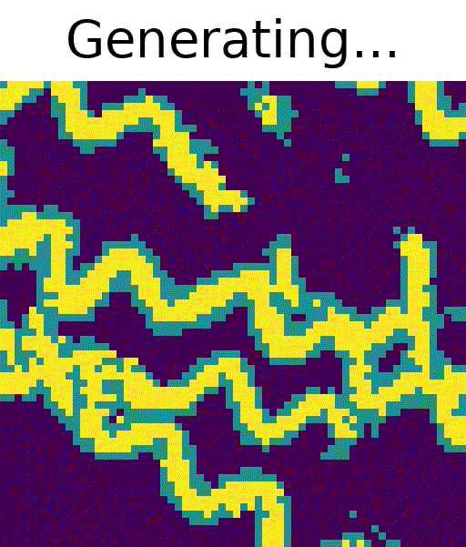
  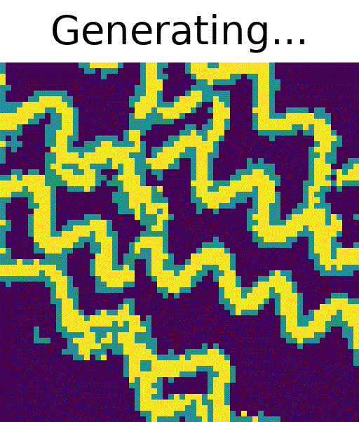
  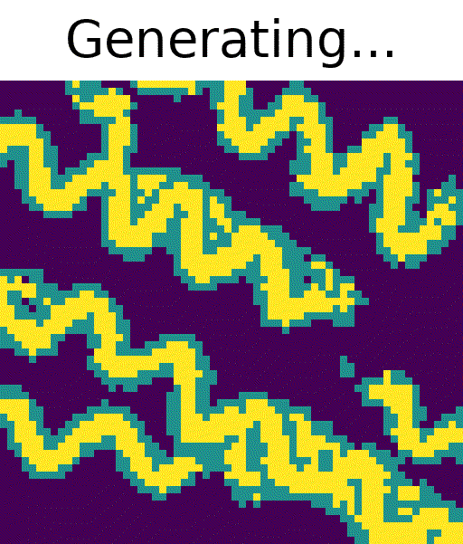
  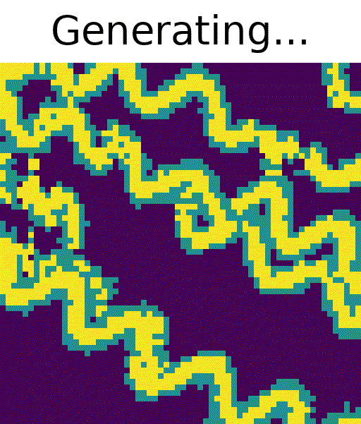
  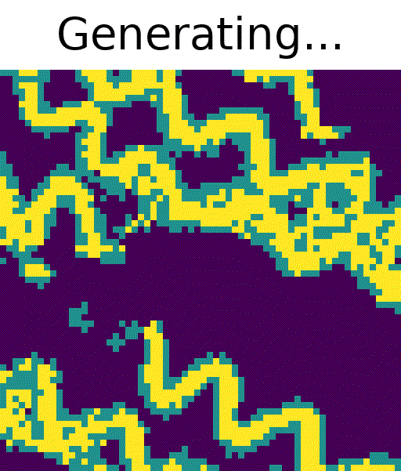
  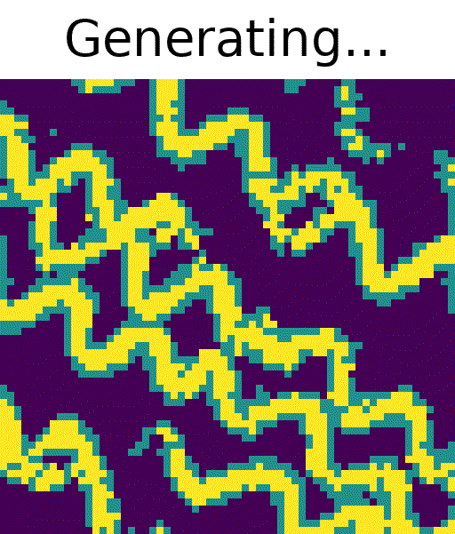

  <em>Figure 1: Random generated samples from 2D-LDM.</em>

  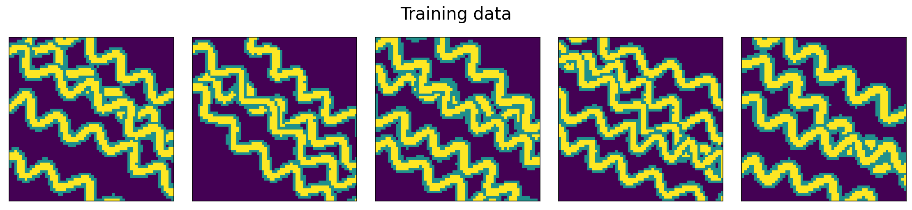

  <em>Figure 2: Random real samples from the dataset.</em>

Our application involves conditional 2D three-facies (channel-levee-mud) systems. The LDM can provide realizations that are visually consistent with samples from geomodeling software. General agreement between the diffusion-generated models and reference realizations can be observed through quantitative metrics involving spatial and flow-response statistics. The smoothness of the parameterization method can be assessed through latent-space interpolation tests. The LDM can then be used for ensemble-based data assimilation. Significant uncertainty reduction, posterior P10-P90 forecasts that generally bracket observed data, and consistent posterior geomodels, can be achieved.

  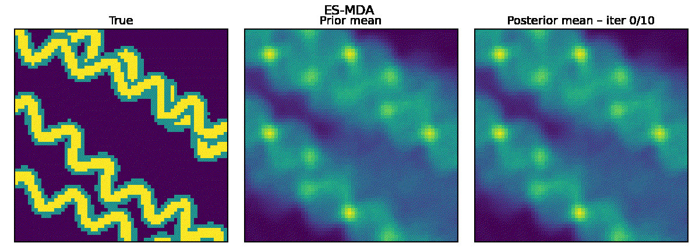

  <em>Figure 3: Synthetic truth and evolving ensemble mean during data assimilation.</em>

  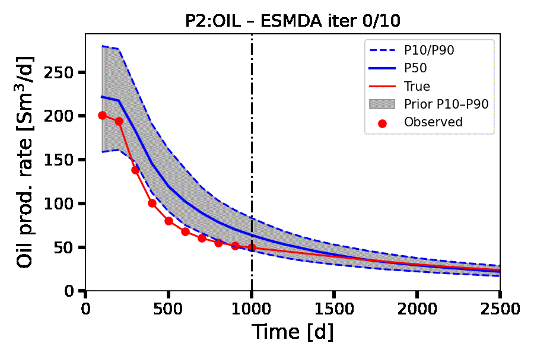
  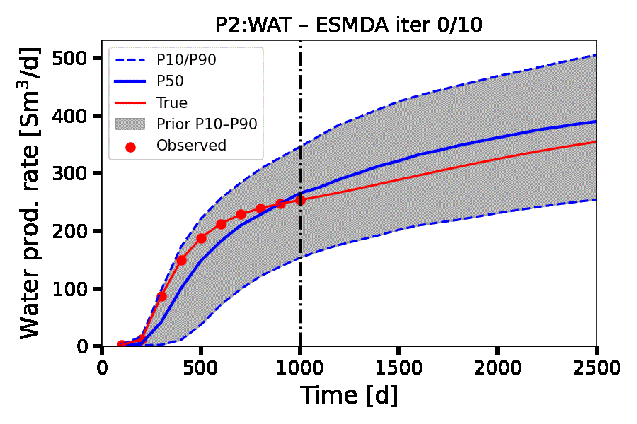
  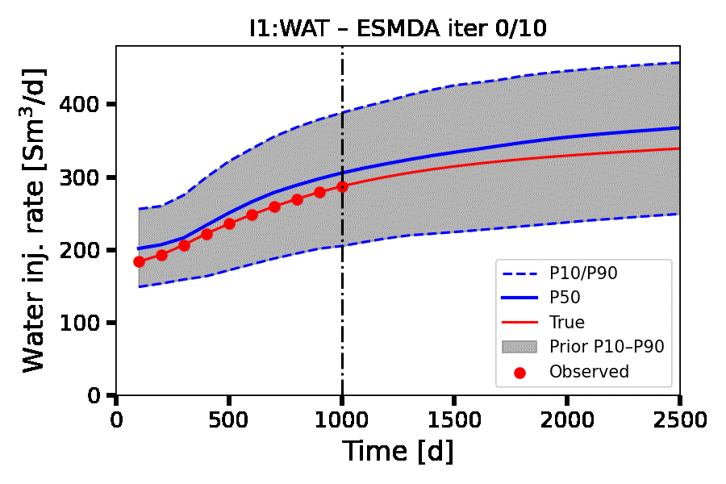

  <em>Figure 4: Evolving well response rates during latent-space data assimilation.</em>

## Contents
- `scripts/` – Scripts for data preparation (`prepare_dataset.py`), VAE training, U-net training and geomodel generation.
- `data/` – Training dataset used in this study (2D three-facies channelized geomodels), stored as a [`datasets.Dataset`](https://huggingface.co/docs/datasets) folder (`diffusers_dataset/`). It is also available [here](https://drive.google.com/drive/folders/1JCaaaJOvfReaqPbIBVtVnPAH7TVc4AA5?usp=sharing), together with the trained VAE and U-net weights.
- `testing/` – Ensembles used for flow simulation and history matching, stored as `.npy` files:
  - `m_petrel_200.npy`: reference ensemble from geomodeling software
  - `m_ldm_200.npy`: LDM-generated ensemble
  - `m_true_1.npy`, `m_true_2.npy`: synthetic "true" models
- `pics/` – Figures and GIFs used in this README.
Code implementations are based on the following repositories:
- [diffusers](https://github.com/huggingface/diffusers/)
- [monai](https://github.com/Project-MONAI/tutorials/tree/main/generative) and [tutorial](https://github.com/Project-MONAI/GenerativeModels/blob/main/tutorials/generative/2d_ldm/2d_ldm_tutorial.ipynb)

## Software requirements
Running the scripts requires the libraries `datasets`,  `diffusers`,  `monai` or  `monai-generative`.
\
This workflow is tested with Python 3.9 and PyTorch 1.8 (CPU/GPU).

## Contact
Guido Di Federico, Louis J. Durlofsky  
Department of Energy Science & Engineering, Stanford University 
\
Contact: gdifede@stanford.edu

## Examples
<figure style="text-align: center; margin-bottom: 100px;">
  
  <figcaption>Noising and denoising process on a geomodel</figcaption>
</figure>

<figure style="text-align: center; margin-bottom: 100px;">
  
  <figcaption>VAE component of the diffusion model</figcaption>
</figure>

<figure style="text-align: center; margin-bottom: 100px;">
  
  <figcaption>Denoising U-net component of the diffusion model</figcaption>
</figure>

<figure style="text-align: center; margin-bottom: 100px;">
  
  <figcaption>Interpolation test on a geomodel using LDM</figcaption>
</figure>

